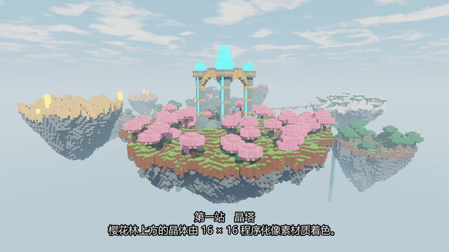

# Voxelith

**A GPU-Driven Voxel Sandbox with Real-Time Ray Tracing**



[下载 Windows x64 免安装版](https://github.com/Ljasonde/voxelith/raw/refs/heads/main/downloads/Voxelith-Windows-x64.zip)

从出生岛沿木桥探索晶塔、沉没神庙和熔岩洞穴。瞄准各遗迹中央基座上的核心，右键回收。带着三枚核心穿过出生岛上的紫色传送门即可结算。途中可拆桥、搭台阶、开飞行或自由建造。

[66 秒实机演示（中文字幕，1080p60）](docs/media/Voxelith-1080p60.mp4) · [4K 实机截图](docs/media/voxelith-4k.png) · [架构与渲染过程](docs/architecture.md) · [逐帧基准与优化记录](docs/benchmark.md)

## 运行与构建

Windows x64，支持 Vulkan 1.3、dynamic rendering 和 synchronization2 的显卡与驱动。发布包解压后双击 `Voxelith.exe`，同目录的 `shaders` 包含预编译着色器。首次启动选择 **New expedition**，有存档时可选择 **Continue expedition**。默认窗口 1600×900，可在暂停菜单调整。

从源码构建需要 Visual Studio 2022 C++ 桌面开发工具（含 CMake、Ninja、Windows SDK）和 Vulkan SDK。首次配置联网下载依赖，固定版本与 SHA-256 在 CMakeLists.txt 中。中文目录下构建脚本使用临时空闲盘符。

```powershell
.\build.cmd
.\out\Release\Voxelith.exe
.\build.cmd Debug
.\out\Debug\Voxelith.exe --validation
```

## 渲染

- 世界由 32³ 区块组成。多线程生成浮岛、洞穴、树冠及遗迹，按材质、方向和顶点 AO 合并共面方块。玩家移动时后台补齐视距周围的网格，VMA staging 将其批量上传至全局顶点、索引缓冲。
- 计算着色器选择可见区块，用原子计数写入间接命令。静止相机额外读取上一帧的最大深度金字塔。可切回逐区块绘制。
- 光栅分支使用三张 2048² 级联阴影图、3×3 PCF 和带双边上采样的半分辨率 SSAO。硬件光追分支按区块建立 BLAS，每帧建立 TLAS，执行太阳软阴影、短程 AO 和水面 / 晶体反射查询。缺少 ray query 特性时使用光栅分支。
- 程序化天空、像素材质数组、高度雾、发光晶体、六层 Bloom、ACES、FXAA。渲染缩放可在 0.7–1.0 调整，HUD 按输出分辨率绘制。

## 操作

| 操作 | 按键 |
|---|---|
| 移动、观察、疾跑 | WASD、鼠标、左 Shift |
| 跳跃、飞行、飞行下降 | 空格、F、左 Ctrl |
| 挖掘、放置或收集核心 | 左键、右键，拾取距离 6 格 |
| 切换建材 | 数字 1–9、滚轮 |
| 暂停、保存、设置、操作说明 | Esc |
| 隐藏 HUD 并锁定环境动画、显示计时面板 | F2、F3 |

世界种子、玩家位置与朝向、时间、选中栏、飞行状态、方块改动和核心进度保存在 exe 旁的 `saves/world.dat`。编辑、暂停或正常退出时保存。

## 性能

RTX 4060 Laptop / 621.01，Windows 11，1920×1080，固定四机位，预热 120 帧、测量 600 帧。窗口组关闭 VSync，包含交换链呈现，无 HUD。

| 窗口配置 | 内部分辨率 | 平均帧时 | P99 帧时 |
|---|---|---:|---:|
| 硬件光追 | 1920×1080 | 1.098 ms | 1.795 ms |
| 级联阴影 + SSAO | 1920×1080 | 0.789 ms | 1.294 ms |
| 硬件光追，缩放 0.7 | 1344×756 | 0.849 ms | 1.388 ms |

```powershell
.\tools\benchmark.ps1
.\out\Release\Voxelith.exe --present --benchmark benchmarks/window --width 1920 --height 1080 --rt 1
.\out\Release\Voxelith.exe --capture captures/spire.png --width 3840 --height 2160 --shot 0
.\out\Release\Voxelith.exe --sequence captures/tour --frames 180 --width 1920 --height 1080
.\out\Release\Voxelith.exe --triangle --validation --frames 120
```

## 实现边界

世界范围为 416×128×416 格，六个群系与遗迹位置由关卡布局指定，种子控制噪声和植被。网格驻留区随玩家移动，体素数据常驻内存。区块编辑或驻留集合变化会引发全局 arena 重打包和光追加速结构重建，交互时可能短暂停顿。固定路线基准单独衡量渲染。

水面单独前向绘制，使用屏幕空间折射、菲涅耳混合和 SSR / ray query 反射。离开屏幕的折射内容只能近似。天空随游玩时间变化，F2 可锁定当前太阳、月亮与星空。15–30 分钟为首次探索的设计目标，尚无人类玩家时长样本。成片由固定相机和游戏交互逻辑驱动。

[开发记录](DEVLOG.md) · [MIT 许可证](LICENSE) · [第三方许可](THIRD_PARTY_NOTICES.md)
