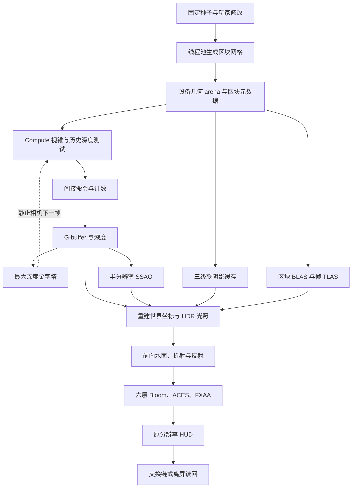

# 从一个方块到屏幕上的一帧

## 世界与交互

`src/world.cpp` 将种子、噪声和岛屿布局转换为 8 位方块 ID。世界高度是 128，区块在三个方向均为 32 格。网格化逐面扫描二维掩码，以材质、方向和四角遮蔽等级作为合并条件。面向空气或水的实体面进入网格，块间边界访问相邻体素。一个顶点占 16 字节，包含世界坐标、面朝向、材质和 AO。21 种非空气 ID 共用 16×16×22 的单通道程序化纹理数组。

`src/player.cpp` 按轴分步移动 0.6×1.8×0.6 的 AABB，碰撞时收缩位移；DDA 比较下一条网格边界的距离，每次跨过一个坐标平面。右键命中核心时更新位掩码，普通方块则在入射面前一格放置。存档采用临时文件写完后在同一卷替换，读取时先验证全部修改再应用。

`src/scene.cpp` 以玩家所在水平区块和视距确定网格驻留集合。进入新区时在快照上后台网格化。替换集合时汇入全局 arena，当前版本在交接处等待旧 GPU 引用结束。基准模式固定驻留集合，排除加载的随机影响。

## 一帧的依赖关系

## 缓冲、深度与同步

`src/scene.cpp` 为两个在途帧各分配间接命令、计数和描述符。compute 前用 transfer 填零，然后以 synchronization2 建立 transfer → compute 和 compute → draw indirect 依赖。每块元数据包含 AABB、首索引、索引数量和顶点偏移。每个工作组有 64 个 invocation，可见块原子追加命令。地形一次间接计数绘制可以消费多个 GPU 命令。

`src/hiz.cpp` 从非反向 Z 的不透明深度构建 R32 最大值金字塔。第一级覆盖输入到二次幂尺寸的完整像素区域；后续层继续取最大值。屏幕矩形决定采样 mip，最近角点仍在最远遮挡深度之后时才能剔除。视图投影变化、网格编辑与缓冲重建均会使旧历史失效。移动时先保留可见几何，静止后才恢复遮挡判定。

`src/gpu.cpp` 管理窗口、设备、双缓冲帧和离屏图像。每个交换链图像持有自己的呈现完成信号量，每个在途帧持有获取信号量、fence 和命令缓冲。命令复用前等待相应 fence；对象按逆创建顺序销毁。交换链调整大小时重建有关图像和描述符。上传暂存区由独立 fence 管理。

## 材质与光照

`shaders/world.frag` 输出反照率与材质 ID、轴对齐法线与顶点 AO；D32 深度单独存储。光照着色器将深度和 NDC 乘逆 VP 后做齐次除法，以恢复世界位置。晶体反射在延迟光照中计算。水面另有索引缓冲与前向着色器 `shaders/water.glsl`，用不透明深度进行遮挡和厚度估计，采样偏移后的反照率近似折射，并按菲涅耳权重混合反射。光栅分支沿屏幕深度步进，光追分支查询 TLAS。镜面二次命中点若可投影至屏幕，会读取命中位置的 G-buffer 材质，屏外命中使用近似环境色。

光栅路径使用 32 / 96 / 256 格覆盖半径的级联，着色时按投影范围选层。静态世界可复用各帧槽自己的阴影深度与矩阵。编辑会使缓存失效。半分辨率 SSAO 对周边深度重建的位置采样，上采样时按重建位置的距离做双边权重。光追路径保留相同的 G-buffer；选择逻辑位于 `src/passes.cpp`。

`src/rays.cpp` 将不透明三角形按区块建立 BLAS，水和传送场排除在加速结构外。底层结构共用对齐后的构建暂存区，连续构建之间插入 AS 写入与下一次读写依赖。两个帧槽分别拥有 TLAS 与自己的 scratch。每次帧构建之后建立 AS build → fragment ray query 依赖。RT 太阳、AO 和反射在同一光照分区内执行。

## 调试、回归与拍摄

`tests/world_tests.cpp` 独立链接 CPU 世界和玩家代码；GPU 验证通过 Release 带 `--validation` 运行。黑屏可由 `--triangle` 开始，再对比去掉剔除、关闭 RT、打开单帧读回的结果。F3 面板的 GPU 时间来自已完成帧槽；历史分区与总时间的边界见 benchmark.md。照片模式隐藏 HUD 与冻结动画，录制则使用 `src/film.cpp` 的可复现镜头，三次核心回收与最终结算均调用玩家逻辑。

